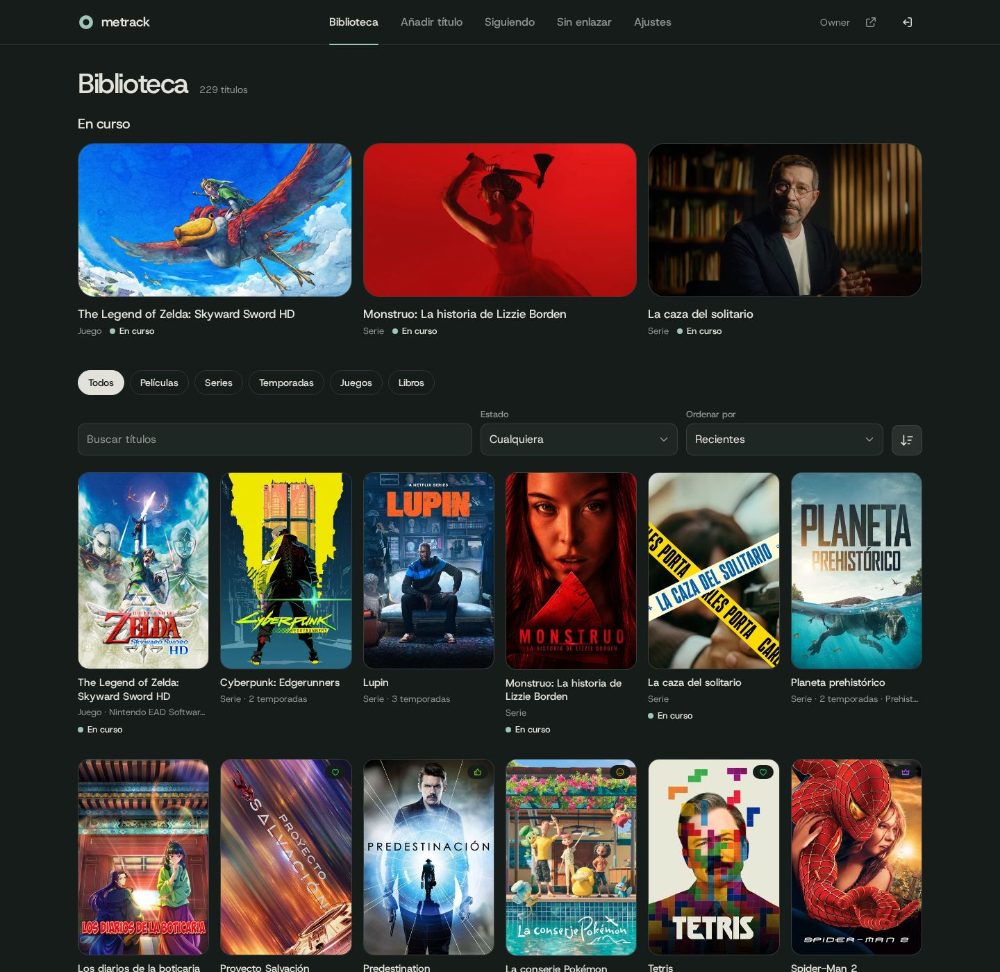
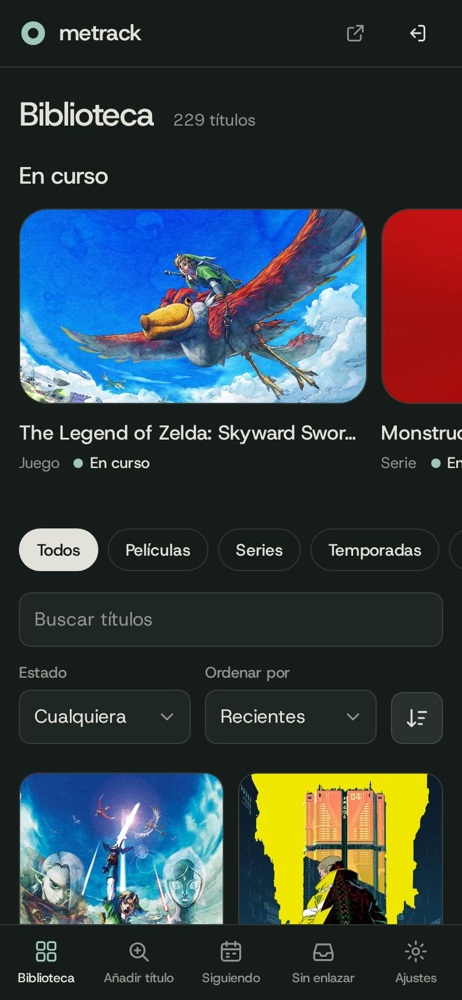
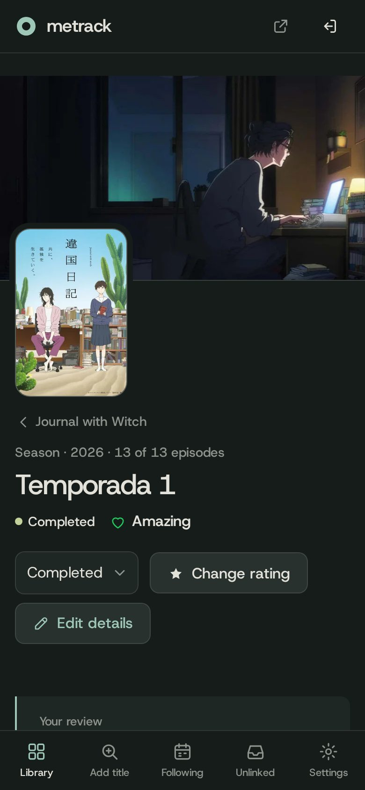
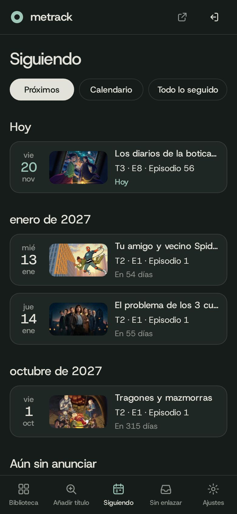

# metrack

[](https://github.com/christt105/metrack/actions/workflows/ci.yml)

Media tracker for movies, series (tracked per season), games and books: a web app to edit your library and public pages that show it. It runs on Cloudflare (a Worker with D1 and R2) or self-hosted in one container with SQLite.



<p>
  
  
  
</p>

More in [docs/screenshots.md](docs/screenshots.md).

## Features

- Web app to add and edit titles, searched and refreshed from TMDB, IGDB and Open Library, or entered by hand.
- Per-season tracking for series: status, dates, rating, review and rewatches.
- Jellyfin viewing sync through Jellystat, with a report-only pass before anything is written.
- Release alerts over ntfy for followed series and movies.
- Scheduled, verified backups with retention and a restore command.

## Two ways to run it

- **Self-hosted:** the Node server with SQLite, run with Docker or from source. Start with [docs/self-hosting.md](docs/self-hosting.md).
- **Cloud:** a Cloudflare Worker with D1 and R2, described in [docs/worker.md](docs/worker.md). The Worker cannot reach Jellyfin, so an optional home connector syncs Jellyfin and Jellystat into it and copies the cloud data; see [docs/connector.md](docs/connector.md).

## Try it

```sh
curl -O https://raw.githubusercontent.com/christt105/metrack/main/docker-compose.yml
DEV_LOGIN=true docker compose up -d
curl http://localhost:8097/api/health
```

Then open `http://<host>:8097` and sign in as the owner (see [docs/users.md](docs/users.md)). Dev login lets anyone who can open the page pick a user with no password, so only use it on a trusted local network.

## Documentation

The full index is [docs/README.md](docs/README.md).

- [docs/self-hosting.md](docs/self-hosting.md): Docker, images and releases, installing the web app.
- [docs/users.md](docs/users.md): security model, per-user settings, your data and deleting an account.
- [docs/public-pages.md](docs/public-pages.md): the public pages of each library.
- [docs/jellyfin-sync.md](docs/jellyfin-sync.md): Jellyfin viewing sync.
- [docs/release-alerts.md](docs/release-alerts.md): release alerts over ntfy.
- [docs/backups.md](docs/backups.md): backups, restore and copy to another disk.
- [docs/mirror.md](docs/mirror.md): mirroring to the Obsidian vault.
- [docs/worker.md](docs/worker.md): the Cloudflare Worker deployment.
- [docs/connector.md](docs/connector.md): the home connector.
- [docs/api.md](docs/api.md): the HTTP API.
- [docs/development.md](docs/development.md): layout, development, dependencies and migrations.

## License

[MIT](LICENSE)
